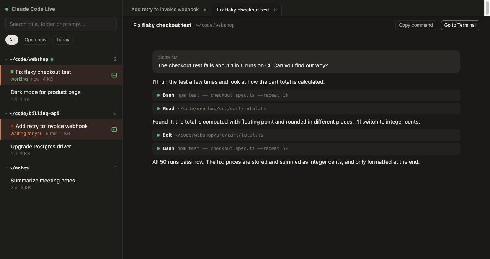

# Claude Code Live

Acompanhe suas sessões do [Claude Code](https://docs.anthropic.com/en/docs/claude-code) ao vivo no navegador. Aparecem todos os projetos e todas as sessões, atualizando enquanto o Claude trabalha. Com um clique, você vai até a aba do Terminal onde a sessão está rodando, ou retoma a sessão numa aba nova.

[Read in English](README.md)



> Projeto da comunidade, não oficial. Sem vínculo com a Anthropic.

## Recursos

- **Todas as sessões num lugar só.** Lê `~/.claude/projects` e agrupa as sessões pela pasta onde começaram. Dá pra buscar por título, pasta ou prompt.
- **Ao vivo.** As sessões abertas atualizam conforme chegam mensagens, chamadas de ferramentas e resultados. Continua rápido mesmo com arquivos de mais de 100 MB.
- **Abas.** Abra várias sessões, feche e reabra. As abas voltam quando você recarrega a página.
- **Status.** Mostra quais sessões estão abertas num terminal agora e se o Claude está *trabalhando* ou *esperando você*.
- **Ir para o Terminal (macOS).** Se a sessão está rodando, traz a aba dela no Terminal.app pra frente. Se não está, abre uma janela nova do Terminal com `claude --resume <id>`.
- **Zero dependências.** Um arquivo Node e uma página HTML. Roda só em `127.0.0.1`.

## Como usar

Precisa do Node.js 20 ou mais novo.

```bash
git clone https://github.com/andersonbuzzi/claude-code-live.git
cd claude-code-live
npm start
# abra http://127.0.0.1:4777
```

Pra ver funcionando sem usar seus dados, rode `npm run demo`. Ele sobe na porta 4778 com sessões fictícias, uma delas atualizando ao vivo.

### Iniciar com o Mac

```bash
./scripts/install-macos.sh            # instala como LaunchAgent: sobe agora e a cada login
./scripts/install-macos.sh uninstall  # remove
```

O log fica em `~/Library/Logs/claude-code-live.log`.

Na primeira vez que você usar "Abrir no Terminal", o macOS pede permissão pro `node` controlar o Terminal. Dá pra mudar depois em Ajustes do Sistema › Privacidade e Segurança › Automação.

## Configuração

| Variável | Padrão | |
|---|---|---|
| `PORT` | `4777` | Porta (sempre em `127.0.0.1`) |
| `CLAUDE_CONFIG_DIR` | `~/.claude` | Onde o Claude Code guarda os dados |

A interface segue o idioma do navegador (português ou inglês). Use `?lang=pt` ou `?lang=en` pra forçar um deles.

## Como funciona

- O Claude Code grava cada sessão em `~/.claude/projects/<pasta>/<id-da-sessão>.jsonl`, com um evento JSON por linha. Pra montar a lista, o servidor lê só o começo e o fim de cada arquivo. Quando o arquivo cresce, as linhas novas vão pro navegador via Server-Sent Events.
- As sessões rodando aparecem em `~/.claude/sessions/<pid>.json`, um arquivo que o Claude Code mantém pra cada processo `claude` aberto, com o id da sessão e o status. O TTY do processo identifica a aba do Terminal.app, que é trazida pra frente via AppleScript.
- O `claude --resume <id>` continua gravando no mesmo arquivo. Assim, a aba que você já tem aberta segue atualizando.

## Limitações

- Só leitura: ainda não dá pra mandar mensagens pelo navegador.
- "Ir para o Terminal" só funciona com o Terminal.app. Se a sessão estiver no iTerm, no VS Code ou em outro app, aparece um aviso.
- O que os subagentes fazem aparece só como a chamada da ferramenta `Agent`, sem os passos internos.
- Sessões muito longas mostram os últimos 4.000 eventos.
- O formato `.jsonl` é interno do Claude Code e pode mudar entre versões. Eventos desconhecidos são ignorados, mas uma atualização do Claude Code pode quebrar partes da visualização.

## Segurança

O servidor só escuta em `127.0.0.1` e recusa pedidos cujo `Host` ou `Origin` não seja local. Assim, outros sites abertos no seu navegador não conseguem ler suas sessões nem acionar o Terminal. O id e a pasta da sessão são validados antes de ler qualquer arquivo, e a pasta sempre vem dos seus próprios arquivos de sessão, nunca do navegador.

## Licença

[MIT](LICENSE)
